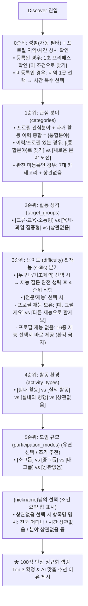

# DISCOVER AI 대화·추천 시스템 종합 명세서

> **프로젝트**: 착착(CHAK CHAK) 선한 영향력 액션 SNS  
> **시스템 명칭**: DISCOVER AI 대화형 맞춤 추천 시스템  
> **담당**: 조장 (홍성은) — AI 토픽 3번 전담 영역  
> **핵심 소스 파일**: 
> - 백엔드 및 인터뷰 엔진: `app/api/ai/discover/route.ts`, `app/api/ai/discover/interview.ts`
> - AI 색인 및 분류: `app/api/ai/classify/route.ts`, `docs/AI-콘텐츠-자동분류-색인-시스템.md`
> - 공통 상수 및 스코어링: `lib/constants/index.ts`, `lib/utils/scoring.ts`
> - 시연 데이터 및 시드: `scripts/seed.mjs`, `scripts/data/action_ai_metadata_all.json`
> - 단위 테스트: `tests/discover-interview.test.ts`, `tests/skills-list.test.ts`
> **최종 갱신일**: 2026-09-28  

---

## 1. 개요 및 핵심 설계 원칙

DISCOVER AI는 사용자와 자연스럽게 대화하며 성향과 조건을 파악하고, 액션의 7대 AI 색인 메타데이터(`classify-v2`)와 대조하여 최적의 액션 3개를 추천하는 AI 어시스턴트입니다.

### 핵심 6대 원칙

1. **100% 로그인 정회원 전용**: 비회원(게스트) 접근은 불가하며, 모든 사용자는 닉네임과 성별이 등록된 인증 회원입니다.
2. **프로필 지역/시간 상시 확인 (Zero-Assumption)**:
   - 사용자의 방문 빈도나 접속 여부를 억측("오랜만이에요" 등)하지 않습니다.
   - **모든 사용자에게 예외 없이 오프닝에서 프로필의 [활동 지역 1곳 / 선호 시간대]를 상시 확인**하여 물리적 제약 조건을 1초 만에 확정합니다.
3. **지역(단일 선택) & 시간(복수 선택) 규칙**:
   - **활동 지역**: 대화 턴이 늘어지는 것을 방지하기 위해 **단 1개 지역(구·군) 또는 전국/상관없음만 단일 선택(Single-select)**합니다. *(※ 비대면/온라인 항목 완전 제외)*
   - **활동 시간**: 유저의 다양한 일정을 수용하기 위해 **복수 선택(Multi-select)**을 지원합니다. 미등록 신규 가입자도 지역 확인 직후 반드시 시간을 확인합니다.
4. **{통합분야} 정밀 도출 규칙 (Profile + History Integration)**:
   - 분야 질문 시 프로필 관심분야(`profile.categories`)와 과거 활동 이력(호스트 + 참여)을 모두 종합하여 `{통합분야}`를 도출합니다.
   - **자기소개글(`bio`)은 분야 분류 시 일체 배제(무시)**하며, 직접 선택한 관심분야와 실제 활동 이력만 객관적으로 반영합니다.
   - **과거 이력 패턴 필터링**: 2회 이상 다회 활동한 분야만 주력 경험으로 우선 추출하고, 산발적인 1회성 참여는 걸러냅니다. (최대 상위 2~3개 압축)
5. **재능 16종 단일 소스 원칙 (`lib/constants`의 `SKILLS`)**:
   - 코드마다 재능 목록을 따로 하드코딩하지 않고, `lib/constants/index.ts`의 `SKILLS`(15종) + `기타(직접 입력 1종)`를 **단일 진실 공급원(Single Source of Truth)**으로 사용합니다.
   - UI(회원가입, 프로필 수정), AI 자동분류(`classify`), Discover 인터뷰(`discover`)가 100% 동일한 재능 상수를 참조합니다.
6. **역할 분담 (서버 코드 스코어링 + AI 감성 서술)**:
   - 하드 필터링 및 100점 만점 랭킹 계산은 **서버 코드가 투명하게 수행**하여 점수 역전 및 환각을 차단하고,
   - AI는 **공감 맞장구, 질문 전개, 선정된 Top 3 액션의 맞춤 추천 이유 서술**에 집중합니다.

---

## 2. 질문 우선순위 파이프라인 (Funnel Architecture)

물리적 제약 조건(지역/시간)을 시작과 동시에 확정하고, 관심사(What) ➔ 활동 성격(Vibe) ➔ 문턱/재능(How) ➔ 환경(Where) 순으로 3~4턴 만에 쾌속 전진합니다.



---

## 3. 상세 대화 시나리오 및 분기 명세

### [0순위: 오프닝 및 지역/시간 상시 확인 (Turn 0)]
*모든 회원에게 공통으로 프로필의 지역(1곳)과 시간(복수)을 점검합니다.*

#### 케이스 A. 프로필에 지역과 시간이 등록되어 있는 경우 (초고속 프리패스)
```text
[AI 오프닝]
"안녕하세요, {nickname}님! 😊
{nickname}님에게 딱 맞는 액션을 찾기 위해 프로필에 등록된 기본 조건을 확인해 봤어요.

📍 활동 지역 : {profileRegion}
⏰ 선호 시간 : {profileTimesSummary} (예: 주말 오후, 평일 저녁)

이 조건 그대로 액션을 찾아드릴까요?"

[선택 버튼]
👉 [네, 이 조건으로 찾을게요 👍]
👉 [이번엔 다른 조건으로 찾을래요 🔄]
```
- **`[네, 이 조건으로 찾을게요]`**: 즉시 확정 ➔ **1순위 질문(관심 분야)으로 바로 직행! (1초 패스)**
- **`[이번엔 다른 조건으로 찾을래요]`**: `[활동할 지역 선택하기 📍]`, `[지역 상관없이 전국 액션 볼래요 🌏]`, 시간대 재선택 제공.

#### 케이스 B. 프로필에 지역이나 시간이 비어 있는 경우 (신규/미입력 회원)
1. 지역 확인:
   > *"안녕하세요, {nickname}님! 만나서 반가워요. 😊  
   > {nickname}님에게 딱 맞는 액션을 찾아드리기 위해 활동하실 지역과 시간을 먼저 확인하고 싶어요. 먼저, 이번에 어느 지역에서 활동하고 싶으세요?"*  
   > `👉 [활동할 지역 선택하기 📍]` (시·군·구 선택창)  
   > `👉 [지역 상관없이 전국 액션 볼래요 🌏]`
2. 시간 확인 (누락 방지):
   > 지역 선택 완료 직후 반드시 시간 복수 선택창 노출:  
   > *"보통 언제 참여하기 편하신가요? (복수 선택 가능)"*  
   > `☑️ 주말 오전` `☑️ 주말 오후` `☑️ 평일 낮` `☑️ 평일 저녁` `☑️ 시간 상관없음`  
   > `👉 [선택 완료]`

---

### [1순위: 관심 분야 (categories) & {통합분야} 분석]

#### {통합분야} 추출 알고리즘
- **입력**: `profile.categories` (프로필 관심분야) + `allPastActions` (호스트 + 참여 액션)
- **규칙**:
  1. 프로필 소개글(`bio`)은 절대 참조하지 않음.
  2. 과거 활동 액션들에서 카테고리별 빈도를 카운팅.
  3. 활동 빈도가 **2회 이상**인 카테고리를 주력 이력으로 필터링. (모든 분야가 1회인 경우 최다/최근 상위 1~2개 선별)
  4. 교집합(프로필 ∩ 주력 이력) ➔ 프로필 관심분야 ➔ 주력 이력 순으로 최대 2~3개 압축 도출.

#### 대화 시나리오
- **{통합분야}가 도출된 회원 (프로필 관심분야 또는 활동 이력 보유)**:
  > *"{nickname}님의 프로필 관심분야와 지난 활동들을 살펴보니 **[{통합분야}]** 분야에 주로 관심과 경험이 있으시네요. 이번에도 이 분야 위주로 찾아드릴까요?"*  
  > 선택 버튼: `[네, 이 분야로 찾을게요 👍]`, `[새로운 분야에 도전해볼래요 🔄]`  
  > *(새로운 분야 선택 시: `[동물]`, `[환경]`, `[지역사회]`, `[아동·청소년]`, `[노인]`, `[장애]`, `[교육]`, `[상관없음]` 노출)*
- **관심분야와 활동 이력이 전혀 없는 신규 회원**:
  > *"어떤 분야의 액션에 가장 관심이 가시나요?"*  
  > 선택 버튼: `[동물]`, `[환경]`, `[지역사회]`, `[아동·청소년]`, `[노인]`, `[장애]`, `[교육]`, `[상관없음]`

---

### [2순위: 활동 성격 및 교류 형태 (target_groups)]
> *"{nickname}님은 어떤 분위기의 활동이 더 끌리시나요?  
> 사람들과 도란도란 소통하고 정을 나누는 활동이 좋으세요, 아니면 땀 흘리고 손발을 맞춰 집중하는 활동이 좋으세요?"*  
> 선택 버튼: `[교류·교육·소통형]`, `[육체·과업·집중형]`, `[상관없음]`

---

### [3순위: 난이도 (difficulty) & 재능 (skills) 스마트 분기]

- **난이도 질문**:
  > *"액션에 따라 난이도가 다를 수 있어요. 어떤 스타일을 원하세요?"*  
  > 선택 버튼: `[누구나 참여가능]`, `[기초 체력 필요]`, `[전문지식/자격/재능 활용]`

- **스마트 분기 규칙**:
  - `[누구나 참여가능]` 또는 `[기초 체력 필요]` 선택 시:  
    ➔ **재능 질문을 완전히 생략하고 4순위 환경 질문으로 즉시 전진!**
  - `[전문지식/자격/재능 활용]` 선택 시:
    - **케이스 1 (프로필에 등록된 재능이 있는 경우)**:  
      > *"{nickname}님의 프로필에 **[{userSkills}]** 재능이 등록되어 있어요. 이 재능을 그대로 활용해서 찾아드릴까요?"*  
      > 선택 버튼: `[예, 그럴게요 👍]`, `[아니요, 다른 재능으로 할게요 🔄]`  
      > *(다른 재능 선택 시 16종 전체 재능 선택지 노출)*
    - **케이스 2 (프로필에 재능이 없는 신규/미입력 사용자인 경우)**:  
      > *(※ 절대 프로필에 재능이 있다고 거짓말/환각하지 않음)*  
      > *"멋져요! 전문지식이나 재능을 나누는 활동은 큰 힘이 됩니다. ✨ 이번 액션에서 {nickname}님이 활용하고 싶은 재능을 아래에서 골라주세요!"*  
      > 선택 버튼: **16종 재능 선택지 바로 노출** (`lib/constants`의 `SKILLS` 15종 + `기타`)
    - **가드레일**: 직접 입력으로 '기타'를 작성한 경우 유해/위험/비윤리적 단어 필터링 동작.

---

### [4순위: 활동 환경 (activity_types)]
> *"어떤 환경에서 활동하고 싶으세요?"*  
> 선택 버튼: `[실내 활동]`, `[실외 활동]`, `[실내외 병행]`, `[상관없음]`

---

### [5순위: 모임 규모 (participation_modes) 및 추천 전환]
> *"함께하는 크루의 규모는 어느 정도가 편하세요?"*  
> 선택 버튼: `[10명 이내 소그룹]`, `[10~20명 중그룹]`, `[20명 이상 대그룹]`, `[상관없음]`

---

### [추천 직전 요약: `{nickname}님의 선택` 및 변명 방지]

1. **요약 헤더 명칭**: 기존 '5가지 질문완료' 등의 비정확한 표현을 폐기하고 **`{nickname}님의 선택`**으로 통일.
2. **'상관없음' 선택 시 항목명 명시 규칙**:
   - 단순히 "상관없음"만 연속 나열되는 UX 결함을 방지하기 위해 항목명을 명확히 표기:
     - `전국 어디나` (지역 상관없음 시)
     - `시간 상관없음`
     - `분야 상관없음`
     - `액션 성격 상관없음`
     - `액션 난이도 상관없음`
     - `실내외 상관없음`
     - `규모 상관없음`
3. **추천 이유 변명 방지 (Fallback Defense)**:
   - 사용자가 실내외 '상관없음'을 선택했을 때 추천 설명문에서 "실내에서 진행되지만~"과 같은 불필요한 변명조 문구를 원천 차단하고 긍정적인 매칭 장점만 서술.

---

## 4. 재능(Skills) 16종 단일 소스 정의 (`lib/constants/index.ts`)

UI, AI 자동분류(`classify`), Discover AI 대화 인터뷰(`interview`)는 오직 아래 16종 표준만을 공유합니다:

| 순번 | 재능 명칭 | 구분 | 비고 |
| :---: | :--- | :---: | :--- |
| 1 | **사진 촬영** | 고정 상수 (`SKILLS[0]`) | UI 칩 및 메타데이터 색인 |
| 2 | **영상 촬영·편집** | 고정 상수 (`SKILLS[1]`) | UI 칩 및 메타데이터 색인 |
| 3 | **디자인** | 고정 상수 (`SKILLS[2]`) | UI 칩 및 메타데이터 색인 |
| 4 | **글쓰기** | 고정 상수 (`SKILLS[3]`) | UI 칩 및 메타데이터 색인 |
| 5 | **SNS 홍보** | 고정 상수 (`SKILLS[4]`) | UI 칩 및 메타데이터 색인 |
| 6 | **요리** | 고정 상수 (`SKILLS[5]`) | UI 칩 및 메타데이터 색인 |
| 7 | **운전** | 고정 상수 (`SKILLS[6]`) | UI 칩 및 메타데이터 색인 |
| 8 | **교육·멘토링** | 고정 상수 (`SKILLS[7]`) | UI 칩 및 메타데이터 색인 |
| 9 | **통역·번역** | 고정 상수 (`SKILLS[8]`) | UI 칩 및 메타데이터 색인 |
| 10 | **컴퓨터·IT** | 고정 상수 (`SKILLS[9]`) | 2026-09-28 신규 확장 |
| 11 | **원예·식물관리** | 고정 상수 (`SKILLS[10]`) | 2026-09-28 신규 확장 |
| 12 | **청소·정리** | 고정 상수 (`SKILLS[11]`) | 2026-09-28 신규 확장 |
| 13 | **미술·공예** | 고정 상수 (`SKILLS[12]`) | 2026-09-28 신규 확장 |
| 14 | **음악·공연** | 고정 상수 (`SKILLS[13]`) | 2026-09-28 신규 확장 |
| 15 | **수리·시공** | 고정 상수 (`SKILLS[14]`) | 2026-09-28 신규 확장 |
| 16 | **기타 (직접 입력)** | UI 특수 입력 / 색인 예외 | `[...SKILLS, '기타']` 형태로 제공, 직접 입력칸 활성화 |

---

## 5. 추천 랭킹 스코어링 (100점 만점 정규화 알고리즘)

서버 코드가 DB의 액션 후보들을 객관적으로 점수화하여 최종 Top 3을 확정합니다.

| 평가 항목 | 배점 | 세부 채점 및 가산점 기준 |
| :--- | :---: | :--- |
| **1. 관심 분야 (categories)** | **25점** | • 선택한 카테고리와 일치 시 **+25점**<br>• `새로운 분야` 선택 시: 과거 이력에 없던 카테고리면 **+10점 가산** (기존 분야는 감점)<br>• `같은 분야` 선택 시: 과거 이력 카테고리면 **+10점 가산** |
| **2. 활동 성격 (target_groups)** | **15점** | • `교류·교육·소통형` or `육체·과업·집중형` 일치 시 **+15점** (`상관없음`은 10점) |
| **3. 참여 난이도 (difficulty)** | **15점** | • 선택한 난이도(`누구나` / `기초체력` / `전문지식`)와 1:1 일치 시 **+15점** |
| **4. 재능 활용 (skills)** | **15점** | • 사용자가 선택한 재능을 액션 모집 항목에서 요구할 경우 **+15점** |
| **5. 활동 환경 (activity_types)** | **10점** | • `실내` / `실외` / `실내외 병행` 일치 시 **+10점** |
| **6. 모임 규모 (participation_modes)** | **10점** | • `소그룹(10명 이하)` / `중그룹` / `대그룹` 일치 시 **+10점** |
| **7. 활동 시간 (time)** | **10점** | • 유저가 복수 선택한 시간대 슬롯 중 액션 일시와 1개라도 겹치면 **+10점** |
| **8. 지역 근접도 (region)** | **10점** | • 선택한 지역 1곳(구·군) 일치 시 **+10점**<br>• 같은 광역시·도 일치 시 **+7점**<br>• 전국/상관없음 액션 **+5점** |
| **★ 시맨틱 키워드 (keywords)** | **보너스 +10점** | • 사용자가 대화 중 자연스럽게 언급한 고유 명사가 액션 keywords에 포함 시 **최대 +10점 가산** |

---

## 6. 시드 데이터 및 7대 메타데이터 동기화 현황

1. **101개 전체 시드 액션 7대 AI 메타데이터**:
   - `action_ai_metadata` 테이블 내 101개 전체 액션이 최신 `classify-v2` 규격으로 100% 색인 완료.
   - [scripts/data/action_ai_metadata_all.json](file:///c:/Users/Donga/Documents/AI%20Agent%20Training/프로젝트/3차/final_proj/scripts/data/action_ai_metadata_all.json)에 영구 보존되어 [scripts/seed.mjs](file:///c:/Users/Donga/Documents/AI%20Agent%20Training/프로젝트/3차/final_proj/scripts/seed.mjs) 실행 시 즉시 upsert되도록 결합.
2. **24개 시드 계정 페르소나 매칭**:
   - 24개 계정의 관심분야와 재능을 7대 표준에 맞춰 개별 설정 (예: 서연: 아동·청소년/교육, 하윤: 노인/지역사회, 준서: 사진/영상 등).
   - 호스트 및 크루 참여 선정 시 관심분야 우선 매칭 알고리즘을 적용하여, 사용자의 과거 활동 이력이 각자의 페르소나와 100% 일치하도록 구축.

---

## 7. 검증 체크리스트 및 완료 현황

- [x] **기획 및 규칙 확정**: 프로필 지역(단일)/시간(복수) 상시 확인 + 5단계 순차 질문 퍼널 수립
- [x] **{통합분야} 도출 로직 (`resolveUnifiedCategories`)**:
  - 프로필 관심분야와 과거 활동 이력(호스트+참여) 종합 분석
  - 자기소개글(`bio`) 완전 배제
  - 2회 이상 다회 참여 빈도 필터링 및 1회성 활동 노이즈 필터링
- [x] **재능 16종 단일 소스 연동**:
  - `lib/constants/index.ts`의 `SKILLS` 15종을 단일 진실 공급원으로 임포트
  - `classify/route.ts`의 `ALLOWED_SKILLS` 및 SYSTEM 프롬프트에 `SKILLS` 연동
  - `discover/interview.ts`의 `ALL_15_SKILLS`에 상대경로로 `SKILLS` 연동
  - `discover/route.ts`의 재능 선택지에서 '기타' 중복 노출 제거
- [x] **신규/미입력 사용자 대화 정합성**:
  - 지역 선택 직후 시간대 미확정 시 시간 질문(`time_pref`) 누락 방지
  - 프로필 재능이 없는 사용자에게 거짓말(환각) 방지 및 16종 선택지 바로 노출
  - 프로필 재능 보유자에게만 "예, 그럴게요 / 다른 재능으로 할게요" 2지선다 노출
- [x] **조건 요약 UI 및 변명 방지**:
  - 요약 제목을 `{nickname}님의 선택`으로 개선
  - 상관없음 선택 시 항목명 명시 (`전국 어디나`, `시간 상관없음`, `분야 상관없음` 등)
  - 환경 상관없음 선택 시 추천 이유 서술에서 불필요한 변명조 멘트 원천 차단
- [x] **101개 시드 액션 및 24개 시드 계정 7대 메타데이터 전수 색인 및 동기화**:
  - 101개 전체 액션 `classify-v2` 100% 색인
  - 24개 계정 페르소나 기반 관심분야/재능 및 호스트/크루 매칭 완료
- [x] **단위 테스트 및 빌드 검증**:
  - 전체 단위 테스트 통과 (`npm test`: **185 pass**, 0 fail)
  - 타입스크립트 컴파일 에러 0건 (`npx tsc --noEmit` 통과)
