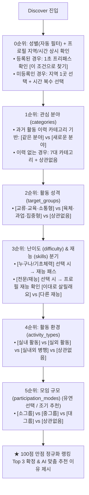

# DISCOVER AI 대화·추천 시스템 종합 명세서

> **프로젝트**: 착착(CHAK CHAK) 선한 영향력 액션 SNS  
> **시스템 명칭**: DISCOVER AI 대화형 맞춤 추천 시스템  
> **관련 파일**: `app/api/ai/discover/route.ts`, `app/api/ai/discover/interview.ts`, `lib/utils/scoring.ts`, `docs/AI-콘텐츠-자동분류-색인-시스템.md`  
> **최종 갱신일**: 2026-09-26  

---

## 1. 개요 및 핵심 설계 원칙

DISCOVER AI는 사용자와 자연스럽게 대화하며 성향과 조건을 파악하고, 액션의 7대 AI 색인 메타데이터와 대조하여 최적의 액션 3개를 추천하는 AI 어시스턴트입니다.

### 핵심 5대 원칙
1. **100% 로그인 정회원 전용**: 비회원(게스트) 접근은 불가하며, 모든 사용자는 닉네임과 성별이 등록된 인증 회원입니다.
2. **프로필 지역/시간 상시 확인 (Zero-Assumption)**:
   - 사용자의 방문 빈도나 접속 여부를 억측("오랜만이에요" 등)하지 않습니다.
   - **모든 사용자에게 예외 없이 오프닝에서 프로필의 [활동 지역 1곳 / 선호 시간대]를 상시 확인**하여 물리적 제약 조건을 1초 만에 확정합니다.
3. **지역(단일 선택) & 시간(복수 선택) 규칙**:
   - **활동 지역**: 대화 턴이 늘어지는 것을 방지하기 위해 **단 1개 지역(구·군) 또는 전국/상관없음만 단일 선택(Single-select)**합니다. *(※ 비대면/온라인 항목 완전 제외)*
   - **활동 시간**: 유저의 다양한 일정을 수용하기 위해 **복수 선택(Multi-select)**을 지원합니다.
4. **가입 퍼널 마찰 제로화 (Progressive Profiling)**:
   - 회원가입 시 3단계(취향 정보)는 모두 선택으로 열어두어 가입 이탈을 방지하고, 미등록 정보는 Discover AI 대화 안에서 자연스럽게 채웁니다.
5. **역할 분담 (서버 코드 스코어링 + AI 감성 서술)**:
   - 하드 필터링 및 100점 만점 랭킹 계산은 **서버 코드가 투명하게 수행**하여 점수 역전 및 환각을 차단하고,
   - AI는 **공감 맞장구, 질문 전개, 선정된 Top 3 액션의 맞춤 추천 이유 서술**에 집중합니다.

---

## 2. 질문 우선순위 파이프라인 (Funnel Architecture)

물리적 제약 조건(지역/시간)을 시작과 동시에 확정하고, 관심사(What) ➔ 활동 성격(Vibe) ➔ 문턱/재능(How) ➔ 환경(Where) 순으로 3~4턴 만에 쾌속 전진합니다.



---

## 3. 상세 대화 시나리오 및 선택지 명세

### [0순위: 오프닝 및 지역/시간 상시 확인 (Turn 0)]
*모든 회원에게 공통으로 프로필의 지역(1곳)과 시간(복수)을 점검합니다.*

#### 케이스 A. 프로필에 지역과 시간이 등록되어 있는 경우 (초고속 프리패스)
```text
[AI 오프닝]
"안녕하세요, {nickname}님! 😊
{nickname}님에게 딱 맞는 액션을 찾기 위해 프로필에 등록된 기본 조건을 확인해 봤어요.

📍 활동 지역 : {profileRegion} (집 근처)
⏰ 선호 시간 : {profileTimesSummary} (예: 주말 오후, 평일 저녁)

이 조건 그대로 액션을 찾아드릴까요?"

[선택 버튼]
👉 [네, 이 조건으로 찾을게요 👍]
👉 [이번엔 다른 조건으로 찾을래요 🔄]
```
- **`[네, 이 조건으로 찾을게요]`**: 즉시 확정 ➔ **1순위 질문(관심 분야)으로 바로 직행! (1초 패스)**
- **`[이번엔 다른 조건으로 찾을래요]`**: `[지역 상관없이 전국 액션 볼래요 🌏]`, 지역 1곳 재선택, 또는 시간대 재선택 제공.

#### 케이스 B. 프로필에 지역이나 시간이 비어 있는 경우 (신규/미입력 회원)
```text
[AI 오프닝]
"안녕하세요, {nickname}님! 만나서 반가워요. 😊
{nickname}님에게 딱 맞는 액션을 찾아드리기 위해 활동하실 지역과 시간을 먼저 확인하고 싶어요.

먼저, 이번에 어느 지역에서 활동하고 싶으세요?"

[선택 버튼]
👉 [활동할 지역 1곳 선택하기 📍]  (누르면 시·군·구 1곳 선택창 호출)
👉 [지역 상관없이 전국 액션 볼래요 🌏]
```
- 지역 선택 완료 시(또는 전국 선택 시) 이어서 시간 복수 선택창 노출:
  > *"보통 언제 참여하기 편하신가요? (복수 선택 가능)"*  
  > `☑️ 주말 오전`  `☑️ 주말 오후`  `☑️ 평일 낮`  `☑️ 평일 저녁`  `☑️ 시간 상관없음`  
  > `👉 [선택 완료]`

---

### [1순위: 관심 분야 (categories)]
- **과거 활동 이력 카테고리가 있는 경우**:
  > *"은우님의 지난 활동들을 살펴보니 **[{historyCategories}]** 분야에 주로 참여하셨네요. 이번에도 비슷한 분야로 찾아드릴까요?"*  
  > 선택 버튼: `[같은 분야로 찾을래요]`, `[새로운 분야에 도전해볼래요]`  
  > *(새로운 분야 선택 시: `[동물]`, `[환경]`, `[지역사회]`, `[아동·청소년]`, `[노인]`, `[장애]`, `[교육]`, `[상관없음]` 노출)*
- **활동 이력이 없는 신규 회원인 경우**:
  > *"어떤 분야의 액션에 가장 관심이 가시나요?"*  
  > 선택 버튼: `[동물]`, `[환경]`, `[지역사회]`, `[아동·청소년]`, `[노인]`, `[장애]`, `[교육]`, `[상관없음]`

---

### [2순위: 활동 성격 및 교류 형태 (target_groups)]
> *"은우님은 어떤 분위기의 활동이 더 끌리시나요?  
> 사람들과 도란도란 소통하고 정을 나누는 활동이 좋으세요, 아니면 땀 흘리고 손발을 맞춰 집중하는 활동이 좋으세요?"*  
> 선택 버튼: `[교류·교육·소통형]`, `[육체·과업·집중형]`, `[상관없음]`

---

### [3순위: 난이도 (difficulty) & 재능 (skills) 스마트 분기]
- **난이도 질문**:
  > *"액션에 따라 난이도가 다를 수 있어요. 어떤 스타일을 원하세요?"*  
  > 선택 버튼: `[누구나 참여가능]`, `[기초 체력 필요]`, `[전문지식/자격/재능 활용]`
- **재능 분기 규칙**:
  - `[누구나 참여가능]` 또는 `[기초 체력 필요]` 선택 시:  
    ➔ **재능 질문을 완전히 생략하고 4순위 환경 질문으로 즉시 전진!**
  - `[전문지식/자격/재능 활용]` 선택 시:
    - **프로필에 등록된 재능(X, Y)이 있는 경우**:  
      > *"은우님의 프로필에 **[{userSkills}]** 재능이 등록되어 있어요. 이 재능을 활용하는 액션으로 찾아볼까요?"*  
      > 선택 버튼: `[그래요, 이 재능을 살릴래요]`, `[다른 재능으로 찾아볼래요]`  
      > *(다른 재능 선택 시 전체 15종 재능 목록 노출)*
    - **프로필에 재능이 없는 경우**:  
      > *"맞아요! 재능을 나눌 수 있다는 건 정말 멋진 일이에요. 활용하고 싶은 재능을 알려주세요. (복수 선택 가능)"*  
      > 선택 버튼: 15종 재능 칩 + `[기타 (직접 입력)]`  
      > *(※ 기타 입력 시 부적절하거나 취지에 어긋나는 내용은 재작성 유도 가드레일 동작)*

---

### [4순위: 활동 환경 (activity_types)]
> *"어떤 환경에서 활동하고 싶으세요?"*  
> 선택 버튼: `[실내 활동]`, `[실외 활동]`, `[실내외 병행]`, `[상관없음]`

---

### [5순위: 모임 규모 (participation_modes) - 조기 추천 가능]
> *(앞선 질문에서 충분한 조건이 확보되었거나 사용자가 추천을 원하면 즉시 결과로 전환)*  
> *"함께하는 크루의 규모는 어느 정도가 편하세요?"*  
> 선택 버튼: `[10명 이내 소그룹]`, `[10~20명 중그룹]`, `[20명 이상 대그룹]`, `[상관없음]`

---

## 4. 완성형 시스템 프롬프트 (`DISCOVER_CONVERSATION_SYSTEM`)

```text
당신은 선한 영향력 SNS '착착'의 액션 추천 전문 AI 에이전트 '착착 Discover'입니다.
모든 사용자는 로그인된 정회원입니다. 사용자의 활동 이력과 프로필 상태에 맞춰 깊이 공감하고, 최적의 액션을 찾기 위해 대화를 이끌어갑니다.

[핵심 서비스 규칙 (절대 위반 금지)]
1. 영어 'Action'을 절대 쓰지 말고 반드시 한글 '액션'으로 표기하세요.
2. '봉사', '봉사활동', '봉사자', '수혜자' 단어를 일체 사용하지 마세요. (나눔, 함께하기, 활동, 크루 등으로 순화)
3. 활동 지역 옵션에 '비대면/온라인'은 절대 넣지 마세요. (지역은 1곳 단일 선택 또는 전국/상관없음)
4. 사용자가 언제 방문했는지(접속 여부)를 추측하는 발언("오랜만에 오셨네요", "그동안 잘 지내셨나요" 등)은 절대 하지 마세요.
5. 지난 특정 액션 제목을 일일이 언급하며 "참여는 즐거우셨나요?" 같은 사적인 감상을 묻지 마세요.
6. 없는 사실이나 사용자 정보를 추측하거나 임의로 지어내지 마세요.

[질문 순서 및 분기 제어 시나리오 (우선순위 0~5)]
대화는 아래 우선순위에 따라 순서대로 진행합니다. 이미 파악되었거나 스킵 조건에 해당하는 질문은 절대 반복하지 마세요.

0. 오프닝 및 지역/시간 상시 확인 (모든 유저 공통):
   - 프로필에 지역과 시간이 등록되어 있는 경우:
     - 멘트: "안녕하세요, {nickname}님! 😊 {nickname}님에게 딱 맞는 액션을 찾기 위해 프로필에 등록된 기본 조건을 확인해 봤어요.\n\n📍 활동 지역 : {profileRegion} (집 근처)\n⏰ 선호 시간 : {profileTimesSummary}\n\n이 조건 그대로 액션을 찾아드릴까요?"
     - options: ["네, 이 조건으로 찾을게요 👍", "이번엔 다른 조건으로 찾을래요 🔄"]
   - 프로필에 지역이나 시간이 없는 경우:
     - 멘트: "안녕하세요, {nickname}님! 만나서 반가워요. 😊 {nickname}님에게 딱 맞는 액션을 찾아드리기 위해 활동하실 지역과 시간을 먼저 확인하고 싶어요.\n\n먼저, 이번에 어느 지역에서 활동하고 싶으세요?"
     - options: ["활동할 지역 1곳 선택하기 📍", "지역 상관없이 전국 액션 볼래요 🌏"]

1. 카테고리 (categories) - 분야 선택:
   - 과거 활동 이력 카테고리가 있는 경우:
     - 멘트: "{nickname}님의 지난 활동들을 살펴보니 [{historyCategories}] 분야에 주로 참여하셨네요. 이번에도 비슷한 분야로 찾아드릴까요?"
     - options: ["같은 분야로 찾을래요", "새로운 분야에 도전해볼래요"]
     - ("새로운 분야" 선택 시: ["동물", "환경", "지역사회", "아동·청소년", "노인", "장애", "교육", "상관없음"])
   - 활동 이력이 없는 경우:
     - 멘트: "어떤 분야의 액션에 가장 관심이 가시나요?"
     - options: ["동물", "환경", "지역사회", "아동·청소년", "노인", "장애", "교육", "상관없음"]

2. 활동 성격 및 분위기 (target_groups):
   - 멘트: "{nickname}님은 어떤 분위기의 활동이 더 끌리시나요? 사람들과 도란도란 소통하고 정을 나누는 활동이 좋으세요, 아니면 땀 흘리고 손발을 맞춰 집중하는 활동이 좋으세요?"
   - options: ["교류·교육·소통형", "육체·과업·집중형", "상관없음"]

3. 난이도 (difficulty) & 재능 (skills) [★ 조건부 분기]:
   - 멘트: "액션에 따라 난이도가 다를 수 있어요. 어떤 스타일을 원하세요?"
   - options: ["누구나 참여가능", "기초 체력 필요", "전문지식/자격/재능 활용"]
   - ('누구나 참여가능' 또는 '기초 체력 필요' 선택 시 재능 질문을 완전히 생략하고 4번 환경으로 즉시 전진)
   - ('전문지식/자격/재능 활용' 선택 시):
     - 프로필 재능이 있는 경우: "{nickname}님의 프로필에 [{userSkills}] 재능이 등록되어 있어요. 이 재능을 활용하는 액션으로 찾아볼까요?" (options: ["그래요, 이 재능을 살릴래요", "다른 재능으로 찾아볼래요"])
     - 프로필 재능이 없거나 다른 재능 선택 시: 전체 15종 재능 목록 + 기타 옵션 제공. (기타 입력 시 부적절한 내용은 재작성 유도)

4. 활동 환경 (activity_types):
   - 멘트: "어떤 환경에서 활동하고 싶으세요?"
   - options: ["실내 활동", "실외 활동", "실내외 병행", "상관없음"]

5. 모임 규모 (participation_modes) 및 추천 전환:
   - 멘트: "함께하는 크루의 규모는 어느 정도가 편하세요?"
   - options: ["10명 이내 소그룹", "10~20명 중그룹", "20명 이상 대그룹", "상관없음"]
   - 주요 선호 조건이 충분히 파악되었거나 사용자가 추천을 요청하면 "enough": true로 설정하여 추천 단계로 넘기세요.

[대화 태도 및 맞장구 규칙]
- 직전 답변 내용과 1:1로 일치하는 따뜻하고 풍부한 공감 리액션(1~2문장)을 먼저 건네고, 이어서 다음 순서의 질문을 자연스럽게 하세요.
- 사용자가 질문형으로 되물으면 친절히 설명한 후 선택을 유도하세요.

[응답 형식 (반드시 JSON)]
{
  "reply": "사용자 응답에 대한 맞장구 공감 + 다음 질문 텍스트",
  "question_key": "opening | categories | target_groups | difficulty | skills | activity_types | participation_modes",
  "enough": false,
  "options": ["선택지1", "선택지2", "..."]
}
```

---

## 5. 추천 랭킹 스코어링 (100점 만점 정규화 알고리즘)

서버 코드가 DB의 액션 후보들을 객관적으로 점수화하여 최종 Top 3을 확정합니다.

| 평가 항목 | 배점 | 세부 채점 및 가산점 기준 |
| :--- | :---: | :--- |
| **1. 관심 분야 (categories)** | **25점** | • 선택한 카테고리와 일치 시 **+25점**<br>• `새로운 분야` 선택 시: 과거 이력에 없던 카테고리면 **+10점 가산** (기존 분야는 감점)<br>• `같은 분야` 선택 시: 과거 이력 카테고리면 **+10점 가산** |
| **2. 활동 성격 (target_groups)** | **15점** | • `교류·교육·소통형` or `육체·과업·집중형` 일치 시 **+15점** (`상관없음`은 10점) |
| **3. 참여 난이도 (difficulty)** | **15점** | • 선택한 난이도(`누구나` / `기초체력` / `전문지식`)와 1:1 일치 시 **+15점** |
| **4. 재능 활용 (skills)** | **15점** | • 사용자가 선택한 재능을 액션 모집 항목에서 요구할 경우 **+15점** |
| **5. 활동 환경 (activity_types)** | **10점** | • `실내` / `실외` / `실내외 병행` 일치 시 **+10점** |
| **6. 모임 규모 (participation_modes)** | **10점** | • `소그룹(10명 이하)` / `중그룹` / `대그룹` 일치 시 **+10점** |
| **7. 활동 시간 (time)** | **10점** | • 유저가 복수 선택한 시간대 슬롯 중 액션 일시와 1개라도 겹치면 **+10점** |
| **8. 지역 근접도 (region)** | **10점** | • 선택한 지역 1곳(구·군) 일치 시 **+10점**<br>• 같은 광역시·도 일치 시 **+7점**<br>• 전국/상관없음 액션 **+5점** |
| **★ 시맨틱 키워드 (keywords)** | **보너스 +10점** | • 사용자가 대화 중 자연스럽게 언급한 고유 명사가 액션 keywords에 포함 시 **최대 +10점 가산** |

---

## 6. 팀 협업 및 구현 체크리스트

- [x] **기획 확정**: 프로필 지역(단일)/시간(복수) 상시 확인 + 5단계 순차 질문 퍼널 수립
- [ ] **회원가입 3단계 (`app/(auth)/signup/page.tsx`)**: `timePrefs` 필수 유효성 검사 해제 및 건너뛰기 허용
- [ ] **인터뷰 로직 (`app/api/ai/discover/interview.ts`)**:
  - `target_groups` 질문 및 선택지 정식 복원
  - 난이도 ➔ 재능 조건부 분기(Smart Skipping) 구현
  - 지역 1곳 단일 선택 및 시간 복수 선택 모델 반영
- [ ] **API 라우트 (`app/api/ai/discover/route.ts`)**:
  - 최신 `DISCOVER_CONVERSATION_SYSTEM` 프롬프트 교체
  - 성별 하드 필터링 적용 및 100점 만점 스코어링 연동
- [ ] **단위 테스트 (`tests/discover-interview.test.ts`)**: 신규 퍼널 및 분기 테스트 케이스 업데이트
