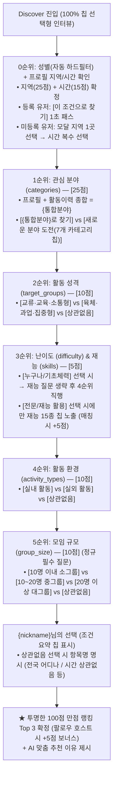

# DISCOVER AI 대화·추천 시스템 종합 명세서

> **프로젝트**: 착착(CHAK CHAK) 선한 영향력 액션 SNS  
> **시스템 명칭**: DISCOVER AI 대화형 맞춤 추천 시스템  
> **담당**: 조장 (홍성은) — DISCOVER AI 대화·추천 전담 (2026-09-29 팀 모임 합의 확정)  
> **핵심 소스 파일**: 
> - 프론트엔드 채팅 인터페이스: `components/action/DiscoverChat.tsx`
> - 백엔드 및 인터뷰 엔진: `app/api/ai/discover/route.ts`, `app/api/ai/discover/interview.ts`
> - 스코어링 및 랭킹: `lib/utils/scoring.ts`, `lib/utils/discover-ranking.ts`
> - AI 색인 및 분류: `app/api/ai/classify/route.ts`, `docs/AI-콘텐츠-자동분류-색인-시스템.md`
> - 공통 상수: `lib/constants/index.ts`
> - 단위 테스트: `tests/discover-interview.test.ts`, `tests/discover-ranking.test.ts`
> **최종 갱신일**: 2026-09-29 (자연어 입력 제거 및 100점 만점 배점 체계 전면 개편 반영)

---

## 1. 개요 및 핵심 설계 원칙

DISCOVER AI는 사용자와 대화하며 성향과 조건을 파악하고, 액션의 7대 AI 색인 메타데이터(`classify-v4`)와 대조하여 최적의 액션 3개를 추천하는 AI 어시스턴트입니다.

### 핵심 8대 원칙

1. **100% 선택지 칩(버튼/모달) 대화형 인터뷰 (자연어 입력창 완전 제거)**:
   - 하단 자유 텍스트 입력창(`<input>`, `<form>`)을 완전히 제거하고 **100% 선택지 칩(버튼 및 모달) 전용 UX**로 통일합니다.
   - 사용자 오타, 긴 문장, 모호한 표현으로 인한 정규식 파서 오인식 및 순위 역전 엣지 케이스를 원천 차단합니다.
   - 모바일 환경에서 가상 키보드가 올라와 화면과 선택지를 가리는 불편함을 없애고, **5~6회 탭만으로 30초 내에 완결**되는 쾌적한 흐름을 제공합니다.
2. **100% 로그인 정회원 전용**:
   - 비회원(게스트) 접근은 불가하며, 모든 사용자는 닉네임과 성별이 등록된 인증 회원입니다.
3. **프로필 지역/시간 상시 확인 (Zero-Assumption)**:
   - 사용자의 방문 빈도나 접속 여부를 억측("오랜만이에요" 등)하지 않습니다.
   - **모든 사용자에게 오프닝에서 프로필의 [활동 지역 1곳 / 선호 시간대]를 상시 확인**하여 물리적 제약 조건을 1초 만에 확정합니다.
4. **엄격한 100점 만점 랭킹 스코어링 체계**:
   - 점수 인플레이션(145점 등)과 비현실적 배점을 폐지하고, **물리적 참여 가능성(지역 25점 + 시간 15점 = 40점)**과 **관심분야(25점)**를 중심으로 한 **순수 100점 만점 체계**로 정규화합니다.
   - 물리적 참여가 불가능한 원거리/불가능 시간대 액션이 1위로 추천되는 왜곡을 원천 방지합니다.
5. **유령 점수 및 왜곡 요인 완전 폐지**:
   - **분야 선호(±10점) 폐지**: 사용자가 선택한 관심분야(25점)와 충돌하여 자기가 고른 분야가 감점되는 왜곡을 방지하기 위해 점수 가감에서 제외하고, 후보군 카테고리 필터링으로만 동작시킵니다.
   - **시맨틱 키워드(최대 10점) 삭제**: 대화에서 추출하지 않던 유령 코드이자 자연어 입력 제거로 완전 삭제합니다.
   - **참여 방식(10점) 삭제**: 실제 데이터상 항상 0점 부여되던 유령 코드를 제거합니다.
6. **{통합분야} 정밀 도출 규칙 (Profile + History Integration)**:
   - 분야 질문 시 프로필 관심분야(`profile.categories`)와 과거 활동 이력(호스트 + 참여)을 종합하여 `{통합분야}`를 도출합니다.
   - **자기소개글(`bio`)은 일체 배제(무시)**하며, 직접 선택한 관심분야와 2회 이상 다회 활동 이력만 객관적으로 반영합니다. (최대 상위 2~3개 압축)
7. **재능 16종 단일 소스 원칙 (`lib/constants`의 `SKILLS`)**:
   - `lib/constants/index.ts`의 `SKILLS`(15종) + `기타(상관없음/재능없이 참여)`를 단일 진실 공급원으로 사용합니다.
8. **복합 모집 액션 호환 및 세부 역할 타겟팅 (Role-Targeting)**:
   - 복합 모집 액션(청소 15명 + 사무 1명 + 요리 2명 등)의 경우, 메타데이터에 성격을 다중 태깅(`['교류·교육·소통형', '육체·과업·집중형']`)하고 난이도는 최저 허들('누구나 참여가능')을 적용하여 초보자 진입 차단을 원천 방지합니다.
   - 추천 이유 생성 레이어(`discover-recommend-v9-role-targeting`)는 액션의 세부 모집 항목(`recruitmentItems`)을 AI에게 전달하여 사용자의 재능/성격이 어떤 세부 파트에 기여할 수 있는지 콕 짚어주는 맞춤형 추천 멘트를 작성합니다.

---

## 2. 질문 우선순위 파이프라인 (Funnel Architecture)

물리적 제약 조건(지역/시간)을 시작과 동시에 확정하고, 관심사(What) ➔ 활동 성격(Vibe) ➔ 난이도/재능(How) ➔ 환경(Where) ➔ 모임 규모(Size) 순으로 빠르게 전진합니다.



---

## 3. 상세 대화 시나리오 및 분기 명세

> 모든 질문은 **버튼(칩) 클릭**으로만 진행되며, 텍스트 직접 입력창은 노출되지 않습니다.

### [0순위: 오프닝 및 지역/시간 상시 확인 (Turn 0)]
*모든 회원에게 공통으로 프로필의 지역(1곳)과 시간(복수)을 점검합니다.*

#### 케이스 A. 프로필에 지역과 시간이 등록되어 있는 경우 (초고속 프리패스)
```text
[AI 오프닝]
"안녕하세요, {nickname}님! 😊
{nickname}님에게 딱 맞는 액션을 찾기 위해 프로필에 등록된 기본 조건을 확인해 봤어요.

📍 활동 지역 : {profileRegion}
⏰ 선호 시간 : {profileTimesSummary} (예: 주말 오후, 평일 저녁)

이 조건 그대로 액션을 찾아드릴까요?"

[선택 버튼]
👉 [네, 이 조건으로 찾을게요 👍]
👉 [이번엔 다른 조건으로 찾을래요 🔄]
```
- **`[네, 이 조건으로 찾을게요]`**: 즉시 지역(25점)·시간(15점) 확정 ➔ **1순위 질문(관심 분야)으로 직행! (1초 패스)**
- **`[이번엔 다른 조건으로 찾을래요]`**: 지역 선택 바텀시트 모달(`[활동할 지역 선택하기 📍]`) 또는 `[지역 상관없이 전국 액션 볼래요 🌏]`, 시간대 복수 선택 제공.

#### 케이스 B. 프로필에 지역이나 시간이 비어 있는 경우 (신규/미입력 회원)
1. **지역 확인**:
   > *"안녕하세요, {nickname}님! 만나서 반가워요. 😊 {nickname}님에게 딱 맞는 액션을 찾아드리기 위해 활동하실 지역과 시간을 먼저 확인하고 싶어요. 먼저, 이번에 어느 지역에서 활동하고 싶으세요?"*  
   > `👉 [활동할 지역 선택하기 📍]` (바텀시트 지역 모달)  
   > `👉 [지역 상관없이 전국 액션 볼래요 🌏]`
2. **시간 확인**:
   > 지역 선택 완료 직후 반드시 시간 복수 선택 블록 노출:  
   > *"보통 언제 참여하기 편하신가요? (복수 선택 가능)"*  
   > `☑️ 주말 오전` `☑️ 주말 오후` `☑️ 평일 낮` `☑️ 평일 저녁` `☑️ 시간 상관없음`  
   > `👉 [선택 완료]`

---

### [1순위: 관심 분야 (categories) & {통합분야} 분석]

- **{통합분야}가 도출된 회원 (프로필 관심분야 또는 활동 이력 보유)**:
  > *"{nickname}님의 프로필 관심분야와 지난 활동들을 살펴보니 **[{통합분야}]** 분야에 주로 관심과 경험이 있으시네요. 이번에도 이 분야 위주로 찾아드릴까요?"*  
  > 선택 버튼: `[네, 이 분야로 찾을게요 👍]`, `[새로운 분야에 도전해볼래요 🔄]`  
  > *(새로운 분야 선택 시: `[동물]`, `[환경]`, `[지역사회]`, `[아동·청소년]`, `[노인]`, `[장애]`, `[교육]`, `[상관없음]` 칩 노출)*
- **관심분야와 활동 이력이 전혀 없는 신규 회원**:
  > *"어떤 분야의 액션에 가장 관심이 가시나요?"*  
  > 선택 버튼: `[동물]`, `[환경]`, `[지역사회]`, `[아동·청소년]`, `[노인]`, `[장애]`, `[교육]`, `[상관없음]`

---

### [2순위: 활동 성격 및 교류 형태 (target_groups)]
> *"{nickname}님은 어떤 분위기의 활동이 더 끌리시나요? 사람들과 도란도란 소통하고 정을 나누는 활동이 좋으세요, 아니면 땀 흘리고 손발을 맞춰 집중하는 활동이 좋으세요?"*  
> 선택 버튼: `[교류·교육·소통형]`, `[육체·과업·집중형]`, `[상관없음]`

---

### [3순위: 난이도 (difficulty) & 재능 (skills) 스마트 분기]

- **난이도 질문**:
  > *"액션에 따라 난이도가 다를 수 있어요. 어떤 스타일을 원하세요?"*  
  > 선택 버튼: `[누구나 참여가능]`, `[기초 체력 필요]`, `[전문지식/자격/재능 활용]`

- **스마트 분기 규칙**:
  - `[누구나 참여가능]` 또는 `[기초 체력 필요]` 선택 시:  
    ➔ **재능 질문을 완전히 생략하고 4순위 환경 질문으로 즉시 직행!**
  - `[전문지식/자격/재능 활용]` 선택 시:
    - **케이스 1 (프로필에 등록된 재능이 있는 경우)**:  
      > *"{nickname}님의 프로필에 **[{userSkills}]** 재능이 등록되어 있어요. 이 재능을 그대로 활용해서 찾아드릴까요?"*  
      > 선택 버튼: `[예, 그럴게요 👍]`, `[아니요, 다른 재능으로 할게요 🔄]`  
      > *(다른 재능 선택 시 15종 전체 재능 선택지 칩 노출)*
    - **케이스 2 (프로필에 재능이 없는 신규/미입력 사용자인 경우)**:  
      > *"멋져요! 전문지식이나 재능을 나누는 활동은 큰 힘이 됩니다. ✨ 이번 액션에서 {nickname}님이 활용하고 싶은 재능을 아래에서 골라주세요!"*  
      > 선택 버튼: **15종 재능 칩 + [특별한 재능 없이 부담 없이 참여]** 버튼 노출

---

### [4순위: 활동 환경 (activity_types)]
> *"어떤 환경에서 활동하고 싶으세요? 날씨 걱정 없는 실내 활동이 좋으신가요, 활기찬 야외 활동이 끌리시나요?"*  
> 선택 버튼: `[실내 활동]`, `[실외 활동]`, `[상관없음]` *(※ 실내외 병행 액션은 실내/실외 선택 유저 모두에게 유연하게 10점 매칭)*

---

### [5순위: 모임 규모 (group_size) — 정규 필수 질문]
> *"함께하는 크루의 규모는 어느 정도가 편하세요?"*  
> 선택 버튼: `[10명 이내 소그룹]`, `[10~20명 중그룹]`, `[20명 이상 대그룹]`, `[상관없음]`

---

### [추천 직전 요약: `{nickname}님의 선택` 및 변명 방지]

1. **요약 헤더 명칭**: **`{nickname}님의 선택`** (질문 칩 요약 표시)
2. **'상관없음' 선택 시 항목명 명시**:
   - `전국 어디나` (지역 상관없음)
   - `시간 상관없음`
   - `분야 상관없음`
   - `액션 성격 상관없음`
   - `액션 난이도 상관없음`
   - `실내외 상관없음`
   - `규모 상관없음`
3. **추천 이유 변명 방지 (Fallback Defense)**:
   - 사용자가 실내외 '상관없음'을 선택했을 때 추천 설명문에서 "실내에서 진행되지만~"과 같은 불필요한 변명조 문구를 원천 차단하고 긍정적인 매칭 장점만 서술.
4. **추천 이유 진실성 보장 및 날조 방지 (`discover-recommend-v10-truth-grounding`)**:
   - **재능 날조(할루시네이션) 절대 금지**:
     - 사용자가 선택한 재능과 액션의 요구 재능이 실제로 일치(`matchedUserSkills`)할 때만 재능 발휘 멘트 작성.
     - 사용자가 보유하지 않은 액션의 다른 재능(예: 사용자는 교육·멘토링인데 액션이 미술·공예인 경우)을 사용자가 가지고 있다고 속이는 거짓 서술 엄격 금지.
     - 일치하는 재능이 없을 때는 재능 언급을 일체 하지 않고, 액션의 분야(노인 복지 등), 따뜻한 대화/정서적 교류 가치로 정직하게 서술.
   - **활동 성격 왜곡 및 '육체적 재능' 날조 금지**:
     - '소통형'과 '과업형'은 모임 분위기이지 '재능'이 아니므로 "육체적이고 집중적인 재능" 같은 기괴한 합성 표현 절대 금지.
     - 말벗, 가정 방문, 대화, 안부 묻기 같은 소통형 액션을 '육체적인 활동', '몸 쓰는 활동'이라고 사실과 다르게 왜곡하는 행위 원천 차단.
   - **세부 모집 항목(recruitmentItems) 역할 타겟팅**:
     - 액션의 세부 모집 항목 중 사용자가 선택한 재능/성향과 부합하는 역할이 있을 때만 구체적 파트명을 언급.
   - **2중 후처리 방어 필터(Sanitization Layer)**:
     - AI가 날조된 재능이나 말벗 봉사에 '육체적/몸 쓰는' 표현을 출력할 경우, 코드 레벨에서 즉시 감지하여 100% 안전한 `fallbackReason`으로 강제 대체.

---

## 4. 재능(Skills) 표준 목록 (`lib/constants/index.ts`)

UI 칩과 AI 자동분류(`classify`), Discover 인터뷰(`interview`)는 오직 아래 표준 상수(`SKILLS`)를 공유합니다:

| 순번 | 재능 명칭 | 구분 | 비고 |
| :---: | :--- | :---: | :--- |
| 1 | **사진 촬영** | 고정 상수 (`SKILLS[0]`) | UI 칩 및 메타데이터 색인 |
| 2 | **영상 촬영·편집** | 고정 상수 (`SKILLS[1]`) | UI 칩 및 메타데이터 색인 |
| 3 | **디자인** | 고정 상수 (`SKILLS[2]`) | UI 칩 및 메타데이터 색인 |
| 4 | **글쓰기** | 고정 상수 (`SKILLS[3]`) | UI 칩 및 메타데이터 색인 |
| 5 | **SNS 홍보** | 고정 상수 (`SKILLS[4]`) | UI 칩 및 메타데이터 색인 |
| 6 | **요리** | 고정 상수 (`SKILLS[5]`) | UI 칩 및 메타데이터 색인 |
| 7 | **운전** | 고정 상수 (`SKILLS[6]`) | UI 칩 및 메타데이터 색인 |
| 8 | **교육·멘토링** | 고정 상수 (`SKILLS[7]`) | UI 칩 및 메타데이터 색인 |
| 9 | **통역·번역** | 고정 상수 (`SKILLS[8]`) | UI 칩 및 메타데이터 색인 |
| 10 | **컴퓨터·IT** | 고정 상수 (`SKILLS[9]`) | 2026-09-28 신규 확장 |
| 11 | **원예·식물관리** | 고정 상수 (`SKILLS[10]`) | 2026-09-28 신규 확장 |
| 12 | **청소·정리** | 고정 상수 (`SKILLS[11]`) | 2026-09-28 신규 확장 |
| 13 | **미술·공예** | 고정 상수 (`SKILLS[12]`) | 2026-09-28 신규 확장 |
| 14 | **음악·공연** | 고정 상수 (`SKILLS[13]`) | 2026-09-28 신규 확장 |
| 15 | **수리·시공** | 고정 상수 (`SKILLS[14]`) | 2026-09-28 신규 확장 |
| — | **특별한 재능 없이 참여** | 선택지 옵션 (`상관없음`) | 텍스트 입력창 없이 칩 클릭으로 처리 |

---

## 5. 추천 랭킹 스코어링 (100점 만점 체계)

서버 코드가 DB의 액션 후보들을 객관적으로 점수화하여 최종 Top 3을 확정합니다.

### 📊 100점 정규 배점표

| 구분 | 평가 항목 | 배점 | 세부 채점 기준 및 로직 |
| :--- | :--- | :---: | :--- |
| **물리적 필수 조건**<br>(40점) | **1. 활동 지역 (region)** | **25점** | • 선택한 지역 1곳(시·군·구) 일치 시 **25점**<br>• 같은 광역시·도 일치 시 **18점**<br>• 전국/상관없음 선택 시 **12점**<br>*(갈 수 없는 원거리 액션이 상위권을 차지하는 왜곡 원천 차단)* |
| | **2. 활동 시간 (time)** | **15점** | • 유저가 선택한 시간대 슬롯 중 액션 일시와 겹칠 시 **15점**<br>• 시간 상관없음 선택 시 **10점** |
| **핵심 관심사**<br>(25점) | **3. 관심 분야 (categories)** | **25점** | • 선택한 분야(또는 통합분야)와 일치 시 **25점**<br>*(분야 선호 점수 충돌 폐지, 선택 분야 단일 평가)* |
| **성향 및 환경**<br>(30점) | **4. 모임 규모 (group_size)** | **10점** | • 소그룹(10명 이하) / 중그룹 / 대그룹 일치 시 **10점**<br>• 규모 상관없음 선택 시 **7점** *(정규 10점 정식 반영)* |
| | **5. 활동 성격 (target_groups)** | **10점** | • `교류·교육·소통형` or `육체·과업·집중형` 일치 시 **10점**<br>• 성격 상관없음 선택 시 **7점**<br>★ **[복합 성격 액션 호환]**: 액션에 `['교류·교육·소통형', '육체·과업·집중형']`이 다중 태깅된 경우, `.some()` 매칭을 통해 소통형 희망자와 과업형 희망자 모두에게 누락 없이 10점 만점 부여 |
| | **6. 활동 환경 (activity_types)** | **10점** | • `실내` / `실외` / `실내외 병행` 일치 시 **10점**<br>• 환경 상관없음 선택 시 **7점** |
| **조건부 매칭**<br>(5점) | **7. 난이도 및 재능 (skills)** | **5점** | • '전문지식/재능 활용' 선택 후 해당 재능 일치 시 **5점**<br>*(액션 39%만 재능을 요구하는 현실 반영, 무관 시 일괄 점수 살포 폐지)*<br>★ **[복합 모집 최저 허들]**: 전문 역할과 일반 역할이 공존하는 액션은 대표 난이도를 최저 허들('누구나 참여가능' 또는 '기초 체력 필요')로 부여하고, 전문 역할은 `skills`에 오픈하여 초보자 필터 차단을 방지하면서 재능 보유자 매칭 보장 |
| **정규 합계** | | **100점** | **대화 인터뷰 5~6문항 완료 시 정확히 100점 만점 기준 평가** |
| *(소셜 보너스)* | **팔로우 호스트 (following)** | **+5점** | • 내가 팔로우한 호스트가 개설한 액션일 경우 **+5점 가산** |

### 🚫 폐지 및 제거된 비정상 항목 (Dead/Harmful Codes)
1. **분야 선호(±10점) 폐지**:
   - 사용자가 '환경'을 직접 골랐는데 과거 이력과 대조하여 감점(-10점)되는 등, 방금 고른 분야가 뒤로 밀리는 심각한 순위 역전을 유발하므로 삭제. 분야는 **관심 분야(25점)**로만 깔끔하게 평가.
2. **시맨틱 키워드(최대 10점) 삭제**:
   - 인터뷰 대화에서 키워드를 추출하는 로직 자체가 없던 100% Dead Code였으며, 자연어 입력창 제거에 따라 완전 삭제.
3. **참여 방식(10점) 삭제**:
   - 실질적으로 모든 액션에 0점만 부여되던 미작동 유령 코드 삭제.

---

## 6. 시드 데이터 및 7대 메타데이터 동기화 현황

1. **101개 전체 시드 액션 7대 AI 메타데이터**:
   - `action_ai_metadata` 테이블 내 101개 전체 액션이 최신 `classify-v4` 규격으로 동기화.
   - [scripts/data/action_ai_metadata_all.json](file:///c:/Users/Donga/Documents/AI%20Agent%20Training/프로젝트/3차/final_proj/scripts/data/action_ai_metadata_all.json)에 영구 보존되어 [scripts/seed.mjs](file:///c:/Users/Donga/Documents/AI%20Agent%20Training/프로젝트/3차/final_proj/scripts/seed.mjs) 실행 시 즉시 upsert되도록 결합.
2. **24개 시드 계정 페르소나 매칭**:
   - 24개 계정의 관심분야와 재능을 7대 표준에 맞춰 개별 설정.
   - 호스트 및 크루 참여 선정 시 관심분야 우선 매칭 알고리즘을 적용하여, 사용자의 과거 활동 이력이 각자의 페르소나와 100% 일치하도록 구축.

---

## 7. 검증 체크리스트 및 완료 현황

- [x] **기획 및 규칙 확정**: 프로필 지역(단일)/시간(복수) 상시 확인 + 5단계 순차 질문 퍼널 수립
- [x] **자연어 입력창 완전 제거 & 100% 칩 인터뷰 확정** (2026-09-29):
  - 하단 text input 폼 제거 및 버튼 탭 전용 UX 구축
  - 시연 중 돌발 입력 및 오타로 인한 파싱 오류 원천 차단
- [x] **100점 만점 랭킹 스코어링 체계 재정립** (2026-09-29):
  - 지역 25점 + 시간 15점 + 관심분야 25점 + 모임규모 10점 + 성격 10점 + 환경 10점 + 재능 5점 = 100점 만점
  - 유령 점수(시맨틱 키워드 10점, 참여방식 10점) 및 점수 왜곡(분야선호 ±10점) 완전 삭제
- [x] **팔로우 호스트 가산점(+5점) 동작 보증** (2026-09-29):
  - `profile.followingIds.includes(action.owner.id)` 정상 가산 확인 및 단위 테스트 검증
- [x] **{통합분야} 도출 로직 (`resolveUnifiedCategories`)**:
  - 프로필 관심분야와 과거 활동 이력(호스트+참여) 종합 분석
  - 자기소개글(`bio`) 완전 배제
  - 2회 이상 다회 참여 빈도 필터링 및 1회성 활동 노이즈 필터링
- [x] **재능 16종 단일 소스 연동**:
  - `lib/constants/index.ts`의 `SKILLS` 15종을 단일 진실 공급원으로 임포트
- [x] **조건 요약 UI 및 변명 방지**:
  - 요약 제목을 `{nickname}님의 선택`으로 개선
  - 상관없음 선택 시 항목명 명시 (`전국 어디나`, `시간 상관없음`, `분야 상관없음` 등)
  - 환경 상관없음 선택 시 추천 이유 서술에서 불필요한 변명조 멘트 원천 차단
- [x] **복합 모집 항목 액션 색인 및 추천 이유 진실성(Truth-Grounding) 보증** (2026-09-29):
  - 활동 성격 복합 공존 시 다중 태깅(`['교류·교육·소통형', '육체·과업·집중형']`) 의무화로 양쪽 성향 유저 10점 만점 매칭
  - 복합 모집 공존 시 난이도 최저 허들 기준('누구나 참여가능'/'기초 체력 필요') 적용 및 전문 역할 `skills` 오픈
  - **재능 날조 및 활동 성격 왜곡 원천 차단 (`discover-recommend-v10-truth-grounding`)**:
    - 미보유 재능 발휘 멘트 금지 (`matchedUserSkills` 기반 엄격 제한)
    - 소통형 액션(말벗 봉사 등)을 육체 활동으로 둔갑시키는 행위 및 '육체적 재능' 날조 금지
    - 세부 모집 항목(`recruitmentItems`) 기반 정직한 역할 타겟팅 및 2중 후처리 방어 필터 적용
- [x] **클로드 코드 리뷰 지적 사항 3건 완벽 개선** (2026-09-29):
  - 1. **대화 화면 재능 질문 판별 안전화**: `DiscoverChat.tsx`에서 하드코딩된 '사진 촬영', '요리' 문자열 대신 `SKILLS` 전역 상수 교집합 검사로 개편하여 명칭 변경 시에도 오작동 방지
  - 2. **트렌드 대시보드 KST 시간대 고정**: `lib/queries/stats.ts`의 `weekLabel` 주차 계산 로직을 KST(+9h) 고정 및 UTC 날짜 추출로 개선하여 배포 서버(UTC) 환경에서의 주차 어긋남 방지
  - 3. **다중 카테고리 누락 방지 전수 집계**: `interview.ts`의 과거 활동 이력 집계에서 단일 `action.category` 외에 다중 `action.categories` 배열도 전수 집계하도록 확장
- [x] **추천 탐색 연속성 보장 (sessionStorage 기반 세션 유지 & 10분 TTL 자동 만료)** (2026-09-29):
  - 사용자가 추천된 3개 액션 중 하나를 클릭해 상세 페이지(`/action/[id]`)를 둘러본 후 뒤로가기로 복귀해도 대화와 추천 3개 카드가 0초 딜레이로 온전히 복원
  - **10분 TTL (Time-To-Live)**: 저장 후 10분이 경과하거나 탭을 닫으면 자동으로 세션을 만료/초기화하여 오래된 추천 노출 방지
  - **수동 리셋**: `[다시 추천받기]` 클릭 시 세션스토리지를 즉시 비우고 새 인터뷰 시작
  - **서버/DB 부하 0%**: 순수 브라우저 `sessionStorage`를 활용하여 DB 및 타 컴포넌트 간섭 없이 조장 담당 영역 내에서 완벽 구현
- [x] **대화 톤앤매너 및 맞장구/질문 어조 대폭 개편 (`discover-chat-v9-natural-tone`)** (2026-09-29):
  - **기계적 칭찬/찬사 원천 차단**: "~하신다니 정말 좋은/멋진 선택이에요!" 같은 상투적인 문구 전면 금지
  - **물리적 조건(지역, 시간, 환경, 규모) 담백한 접수 멘트로 개편**: 지역/시간 선택 시 억지 칭찬 대신 "서울특별시 지역으로 찾아볼게요. 📍", "주말 시간대로 체크해둘게요. ⏰"처럼 자연스러운 확인과 브릿지 멘트만 제공
  - **어색한 번역투 접속사('이제', '보통') 제거**: "이제 보통 언제 참여하기 편하신가요?" 등의 어색한 문장을 "활동하기 편한 요일이나 시간대가 있으신가요? (복수 선택 가능)"로 정돈
  - 주관적 가치관/관심분야(카테고리, 활동 분위기)에만 자연스러운 공감("동물들과 교감하는 시간을 좋아하시는군요! 🐾") 적용
- [x] **추천 이유 진실성 및 조건 완화 날조 방어 (`discover-recommend-v11-truth-grounding`)** (2026-09-29):
  - **불일치 환경 왜곡 방지**: 순수 실내 활동(도서 분류 등)을 '실외에서 땀 흘리며'로 날조하는 환각 차단 (프롬프트 엄명 및 실내/실외 2중 후처리 필터)
  - **불일치 시간대 억지 칭찬 차단**: 주말 희망 유저에게 평일 액션 추천 시 '평일이라 시간도 잘 맞을 것 같아요' 같은 거짓말/억지 부리기 금지
  - **불일치 조건 묵비 및 본질 집중**: 완화로 추천된 액션의 불일치 속성은 일체 언급하지 않고, 액션 고유의 사회적 가치/보람/진행 내용만 진솔하게 서술하도록 개선
- [x] **신규가입자 + 전체 상관없음 추천 원리 투명화**:
  - 전 조건 상관없음 시 68점 동점 산출 (관심분야 25, 지역 12, 시간 10, 규모 7, 성격 7, 환경 7)
  - 동점자 정렬 룰에 의해 **활동 시작일(`activityStartAt`)이 가장 가까운(임박한) 순서**대로 상위 3개 액션 선정
- [x] **분야 선택 후 중복 질문 방지 및 말풍선-선택지 1:1 일치 보장 (`discover-chat-v10-flow-integrity`)** (2026-09-29):
  - **카테고리 선택 후 중복 질문 차단**: 사용자가 특정 카테고리(장애 등)를 선택한 직후 "이번에도 이 분야 위주로 찾아드릴까요?"라며 되묻는 환각 원천 금지
  - **질문 순서 건너뛰기(스킵) 방지**: AI가 2번 성격 질문을 건너뛰고 난이도로 튀지 않도록 남은 질문의 최우선 순위(`remainingQuestionKeys[0]`)로 질문 순서 강제
  - **말풍선과 선택지 옵션 엇박자 4중 방어 (`isQuestionMismatch`)**: 말풍선은 카테고리를 묻는데 버튼은 난이도가 나오는 등 질문 내용과 선택지 간 불일치 감지 시 즉시 100% 일치하는 정제된 질문(`fallback.reply`)으로 자동 교체
  - **질문 키 동의어 정규화 (`normalizeQuestionKey`)**: `target_groups`와 `vibe_preference`, `categories`와 `field_preference` 간 매핑 일원화
- [x] **단위 테스트 및 빌드 검증**:
  - 전체 단위 테스트 통과 (`npm test`: **206 pass**, 0 fail)
  - 타입스크립트 컴파일 에러 0건 (`npx tsc --noEmit` 통과)
